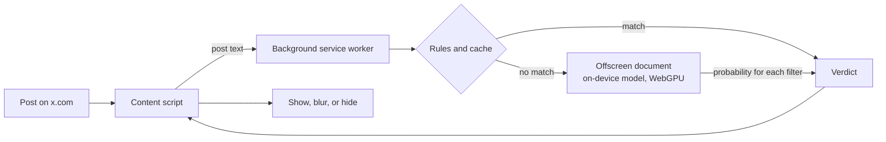

<div align="center">


# X Feed Filter

**Remove the posts that you do not want to see on X. Write the rules in plain language.**<br>
A small AI model runs on your computer. Your posts do not go to a server.

[](https://github.com/silentvoice/x-feed-filter/actions/workflows/ci.yml)
[](https://github.com/silentvoice/x-feed-filter/actions/workflows/codeql.yml)
[](LICENSE)
[](docs/style-guide.md)

[Features](#features) · [Install](#install) · [Use](#use) · [How it works](#how-it-works) · [Contribute](#contribute)

</div>

> [!NOTE]
> This project is in early development. The rules, the settings, and the interface work now. The on-device model is in progress. See the [roadmap](docs/roadmap.md).

## Features

- **Filters in plain language.** Type a description, for example "posts about layoffs". The extension removes the posts that match it.
- **Built-in filters.** Turn on filters for rage bait, engagement bait, doomposting, politics, crypto scams, low-effort AI hype, and hostile replies.
- **Blur or hide.** By default, a filtered post is blurred. The blur shows the reason and a **Show** button. You can also remove filtered posts fully.
- **No flash of filtered content.** New posts stay blurred until the extension checks them.
- **Strictness control.** One slider sets how sure the model must be before it filters a post.
- **Private by design.** The model runs on your device with WebGPU. The extension does not collect data. It has no server and needs no account.
- **Muted words and an allowlist.** Hide posts that contain specific words. Never filter the accounts that you trust.

## Install

> [!IMPORTANT]
> The extension is not in the Chrome Web Store yet. Use the procedure that follows to install a development build.

Requirements:

- Google Chrome 124 or later on desktop
- Node.js 22 or later
- A Mac with Apple silicon (recommended for the model). Other computers with WebGPU also work.

1. Clone the repository:

   ```bash
   git clone https://github.com/silentvoice/x-feed-filter.git
   ```

2. Go to the project folder and install the dependencies:

   ```bash
   cd x-feed-filter && npm install
   ```

3. Build the extension:

   ```bash
   npm run build
   ```

4. In Chrome, open `chrome://extensions`.
5. Turn on **Developer mode**.
6. Click **Load unpacked**.
7. Select the `.output/chrome-mv3` folder.

## Use

1. Open [x.com](https://x.com).
2. Click the extension icon in the Chrome toolbar.
3. Turn on the filters that you want.
4. To add your own filter, click **Add your own filter**. Then type a description of the posts to remove.
5. Move the **Strictness** slider to change how many posts the extension filters.

For help with filter descriptions, read [Writing good filters](docs/writing-filters.md).

## How it works



1. The content script finds each post on the page and reads its text.
2. The background service worker applies muted words, the allowlist, and the cache first.
3. For the remaining posts, the offscreen document runs the model. The model gives a probability for each filter.
4. If a probability is more than the strictness threshold, the content script blurs or hides the post.

For more information, read the [architecture document](docs/architecture.md) and the [model selection document](docs/model-selection.md).

## Documentation

| Document | Content |
|---|---|
| [Architecture](docs/architecture.md) | Components, data flow, and design decisions |
| [Model selection](docs/model-selection.md) | The models that we compared and the model that we use |
| [Writing good filters](docs/writing-filters.md) | How to write filter descriptions that work well |
| [Development](docs/development.md) | Set up, build, test, and debug the extension |
| [Roadmap](docs/roadmap.md) | Milestones and status |
| [Privacy](docs/privacy.md) | The data that the extension uses and stores |
| [Documentation style guide](docs/style-guide.md) | The ASD-STE100 rules for all documents in this repository |

## Contribute

Contributions are welcome. Read the [contribution guide](CONTRIBUTING.md) before you open a pull request. All contributors must obey the [code of conduct](CODE_OF_CONDUCT.md).

To report a security problem, do not open a public issue. Use the procedure in [SECURITY.md](SECURITY.md).

## License

The source code is available under the [Apache License 2.0](LICENSE).

The extension downloads model weights at runtime. The weights are not part of this repository and have their own licenses. For example, the Liquid AI d1 models use the LFM Open License v1.0. Read [NOTICE](NOTICE) and the [model selection document](docs/model-selection.md#licenses).

This project is not affiliated with X Corp.
