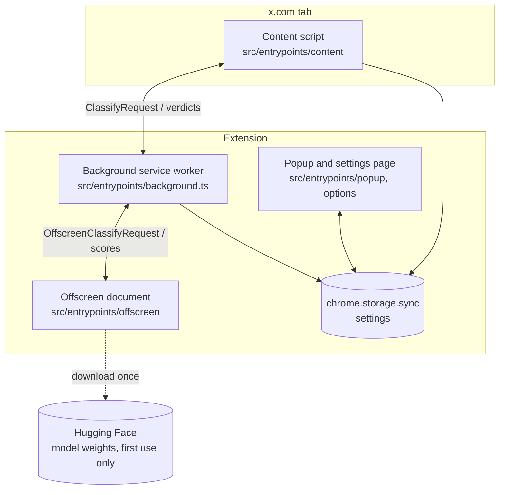

# Architecture

This document gives the components of the extension and the data flow between them.

## Components



| Component | Responsibility |
|---|---|
| Content script | Finds posts on x.com. Reads the text. Blurs or hides posts. |
| Background service worker | Applies rules and the cache. Sends the other posts to the model. Converts scores to verdicts. |
| Offscreen document | Runs the model with ONNX Runtime Web on WebGPU. Manifest V3 service workers cannot use WebGPU. Thus, the model runs in an offscreen document. |
| Popup and settings page | Show and change the settings. |
| `chrome.storage.sync` | Keeps the settings. Chrome syncs them between the user's computers. |

## Data flow for one post

1. X adds a post to the page. A `MutationObserver` in the content script sees the change.
2. The content script reads the post with `extractPost()` (`src/lib/x-dom/extract.ts`).
3. If "pending blur" is on, the content script blurs the post.
4. The content script collects up to 8 posts. Then it sends them to the background in one `ClassifyRequest`.
5. The background applies `applyRules()`: the allowlist, promoted posts, and muted words.
6. The background looks for each remaining post in the verdict cache.
7. The background sends the remaining posts and the active filters to the offscreen document.
8. The model gives one probability for each (post, filter) pair.
9. `verdictFromScores()` compares each probability with the threshold. The threshold comes from the strictness setting.
10. The content script removes the pending blur. Then it shows, blurs, or hides the post.

## Design decisions

### Fail open

If an error occurs, the extension shows the post. A broken filter must not hide the feed.

### One module for X selectors

X changes its HTML often. All selectors are in `src/lib/x-dom/selectors.ts`. When X changes its HTML, update that file only. Use `data-testid` attributes. They change less often than class names.

### Virtualized timeline

X removes posts from the page when they go out of view. X also uses the same `<article>` element again for a different post. Thus, the content script keeps the post ID in `data-xff-id`. It compares the ID each time. It does not use a "seen" flag.

### Pluggable models

All models use the `ClassifierBackend` interface (`src/lib/classifier/backend.ts`). The background selects a backend from the settings. To add a model, add a class that implements the interface.

### Model rows

The d1 model answers one question about one text in each row. Thus, the backend makes one row for each (post, filter) pair. The rows go to the model in batches of up to 8192 tokens. Rows of similar length go together, to reduce padding.

Each row is about 75 tokens: the post text, the filter question, and two answer options. A row is limited to 512 tokens. This limit truncates only very long posts.

### Threshold

One strictness value (0 to 1) controls all filters:

```
threshold = 0.85 − 0.6 × strictness
```

Strictness 0 filters a post only when the probability is 0.85 or more. The default strictness (0.5) filters a post when the probability is 0.55 or more. Strictness 1 filters a post when the probability is 0.25 or more.

On real posts, d1 gives off-topic posts a probability of about 0 to 0.1. It gives on-topic posts 0.25 to 0.98. These values are provisional. The evaluation set of milestone M3 will tune them. Later releases can add a threshold for each filter.

### Cache

The cache key contains the post ID and a hash of the active filters and the strictness. When the settings change, the extension does not use old verdicts.

## Permissions

| Permission | Reason |
|---|---|
| `storage` | Keep the settings. |
| `offscreen` | Run the model in an offscreen document with WebGPU. |
| `wasm-unsafe-eval` (content security policy) | Compile the ONNX Runtime WebAssembly file, which is in the extension package. |
| `x.com`, `twitter.com` hosts | Run the content script on X. |

The extension does not request other permissions. Each new permission needs a reason in this table.
